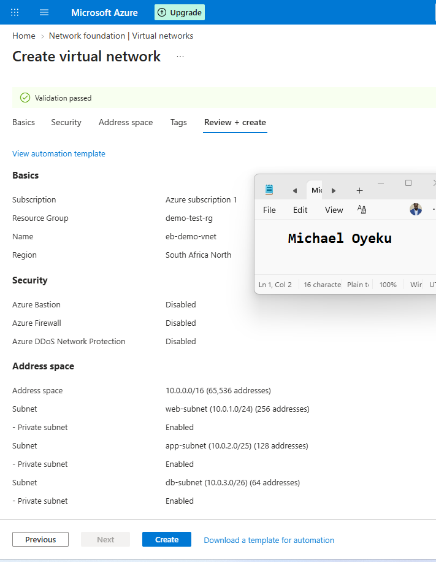
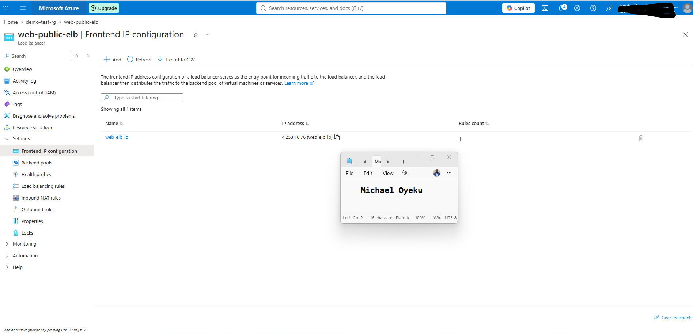
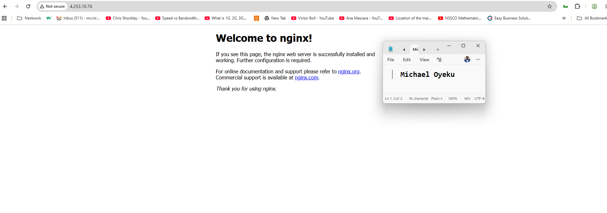

# Assignment 3 — Design a Three-Tier Network with Load Balancer on Azure

<<<<<<< HEAD
Part of the DevOps Micro Internship (DMI) Cohort 3 with Agentic AI
=======
Part of the DevOps Micro Internship (DMI) with Agentic AI
>>>>>>> upstream/main

---

## Purpose

<<<<<<< HEAD
In this assignment, you will design and deploy a three-tier network architecture on Azure using a Virtual Network, subnets, a Virtual Machine, NGINX, and a Public Load Balancer. The web, application, and database tiers are separated into dedicated subnets, and a Public Load Balancer provides the application entry point.

---

# Task 1 — Create a Virtual Network with Three Subnets

## Goal

Create `eb-demo-vnet` (10.0.0.0/16) with `web-subnet` (10.0.1.0/24), `app-subnet` (10.0.2.0/25), and `db-subnet` (10.0.3.0/26), inside Resource Group `vnet-demo-rg`.

### Evidence

#### Screenshot 1 — Subnet configuration screen showing the three subnets and Bastion subnet (if enabled)

# Task 2 — Deploy the Web VM and Install NGINX

## Goal

Create Ubuntu 22.04 LTS VM `web-nginx` in `web-subnet` with a public IP and inbound SSH (22) and HTTP (80), then install and start NGINX and verify the default page via the VM's public IP.

> No screenshot required for this task. Completion is verified through Task 4.

---

# Task 3 — Create a Public Load Balancer

## Goal

Create Standard Public Load Balancer `web-public-elb` with frontend IP `web-elb-ip`, backend pool `web-backend-pool` (containing `web-nginx`), a TCP port-80 health probe `web-health-probe`, and load-balancing rule `web-http-rule`.

### Evidence

#### Screenshot 2 — Load Balancer frontend IP configuration

# Task 4 — Test the Architecture

## Goal

Confirm the NGINX default page is reachable through the Load Balancer's public IP.

### Evidence

#### Screenshot 3 — Browser showing the NGINX welcome page through the Load Balancer Public IP

# Task 5 — Clean Up Resources

## Goal

After capturing all required evidence, delete the `vnet-demo-rg` Resource Group to avoid ongoing charges.

> No screenshot required for this task.

---

# Submission Instructions

- Add all required screenshots in your submission
- Capture all evidence before deleting the Resource Group
- Do not expose passwords or sensitive Azure account information
=======
In this assignment, you will create an Azure Virtual Network with separate web, application, and database subnets. You will deploy an Ubuntu VM running NGINX in the web subnet and make it accessible through a Public Load Balancer. The application and database subnets will remain empty.

---

# Task 1 — Create a Resource Group

## Goal

Create Resource Group `vnet-demo-rg` in Central India or your selected Azure region.

## Evidence

#### Screenshot 1 — Resource Group Overview showing `vnet-demo-rg` and its region

Add your screenshot here.

---

# Task 2 — Create a Virtual Network

## Goal

Create `eb-demo-vnet` (`10.0.0.0/16`) in `vnet-demo-rg` with `web-subnet` (`10.0.2.0/24`), `app-subnet` (`10.0.3.0/25`), and `db-subnet` (`10.0.4.0/26`). Azure Bastion is optional.

## Evidence

#### Screenshot 2 — VNet address space showing `eb-demo-vnet` uses `10.0.0.0/16`

Add your screenshot here.

---

#### Screenshot 3 — Subnets list showing the three required subnet names and CIDR ranges, including the Bastion subnet if applicable

Add your screenshot here.

---

# Task 3 — Create a VM in the Web Subnet

## Goal

Deploy Ubuntu 22.04 LTS VM `web-nginx` in `web-subnet`, inside `vnet-demo-rg`, with a public IP and inbound SSH (22) and HTTP (80). Use SSH public key or password authentication.

## Evidence

#### Screenshot 4 — VM Overview showing `web-nginx`, its running status, and public IP

Add your screenshot here.

---

#### Screenshot 5 — VM Networking configuration showing `eb-demo-vnet`, `web-subnet`, and inbound rules allowing SSH 22 and HTTP 80

Add your screenshot here.

---

# Task 4 — Install and Configure NGINX

## Goal

Install, enable, and start NGINX on `web-nginx`, then verify the default page through the VM’s public IP.

## Evidence

#### Screenshot 6 — Terminal showing `sudo systemctl status nginx --no-pager` with NGINX active and running

Add your screenshot here.

---

#### Screenshot 7 — Browser showing the NGINX welcome page through the VM Public IP, with the address bar visible

Add your screenshot here.

---

# Task 5 — Create a Public Load Balancer

## Goal

Create Standard Public Load Balancer `web-public-elb` in `vnet-demo-rg`, with frontend public IP `web-elb-ip` and NIC-based backend pool `web-backend-pool` containing `web-nginx`. Configure `web-health-probe` using TCP port 80 with a five-second interval, and associate it with `web-http-rule` using TCP ports 80 → 80.

## Evidence

#### Screenshot 8 — Load Balancer frontend configuration showing its public IP

Add your screenshot here.

---

#### Screenshot 9 — `web-http-rule` configuration showing the frontend, `web-backend-pool`, TCP ports 80 → 80, and `web-health-probe`

Add your screenshot here.

---

# Task 6 — Test the Architecture

## Goal

Confirm that the NGINX default page is accessible through the Load Balancer’s public IP.

## Evidence

#### Screenshot 10 — Browser showing the NGINX welcome page through the Load Balancer Public IP, with the address bar visible

Add your screenshot here.

---

# Task 7 — Clean Up Resources

## Goal

Save Screenshots 1–10, then delete Resource Group `vnet-demo-rg` to avoid ongoing charges.

## Evidence

#### Screenshot 11 — Evidence confirming deletion of `vnet-demo-rg`, such as an Azure success notification or the Resource Groups list showing no results when filtered by its name

Add your screenshot here.

---

# LinkedIn Post (Required)

## Goal

Publish a LinkedIn post sharing your Azure deployment, including a screenshot of NGINX accessed through the Load Balancer’s public IP and three to five lines on what you built, what you learned, and a challenge you resolved. Clarify that only the web-tier VM was deployed and mention resource cleanup. Include **#DMIByPravinMishra #Azure #DevOps #CloudComputing**.

## Evidence

#### LinkedIn Post URL

Paste your LinkedIn post URL here:

`Add your URL here`

---

#### Screenshot 12 — Published LinkedIn post showing your caption and deployment screenshot

Add your screenshot here.

---
# Submission Instructions

- Add Screenshots **1–12** under the corresponding tasks.
- Include your published **LinkedIn post URL**.
- Capture Screenshots **1–10 before deleting the Resource Group**.
- Capture Screenshot **11 after deletion** and Screenshot **12 after publishing your LinkedIn post**.
- Ensure screenshots are readable and meet the full-name requirement in the assignment guidelines.
- Do not expose passwords, private keys, subscription IDs, or other sensitive Azure account information.
>>>>>>> upstream/main

---

# Completion Checklist

<<<<<<< HEAD
- [ ] Task 1: VNet and three subnets created (Screenshot 1)
- [ ] Task 2: Web VM created and NGINX installed and verified
- [ ] Task 3: Public Load Balancer configured (Screenshot 2)
- [ ] Task 4: NGINX reachable through the Load Balancer public IP (Screenshot 3)
- [ ] Task 5: Resource Group deleted after evidence was captured
- [ ] No sensitive data exposed

=======
- [ ] Task 1: Resource Group created (Screenshot 1)
- [ ] Task 2: VNet and three required subnets created (Screenshots 2–3)
- [ ] Task 3: Web VM deployed with the required networking configuration (Screenshots 4–5)
- [ ] Task 4: NGINX running and verified through the VM public IP (Screenshots 6–7)
- [ ] Task 5: Public Load Balancer configured (Screenshots 8–9)
- [ ] Task 6: NGINX reachable through the Load Balancer public IP (Screenshot 10)
- [ ] Task 7: Resource Group deleted after saving deployment evidence (Screenshot 11)
- [ ] LinkedIn post published with the required hashtags (Screenshot 12)
- [ ] LinkedIn post URL included
- [ ] All required screenshots are readable and meet the full-name requirement
- [ ] No sensitive information exposed
>>>>>>> upstream/main
---

## 📌 About DMI & CloudAdvisory

DevOps Micro Internship (DMI) is a project-based DevOps program run by Pravin Mishra (The CloudAdvisory) focused on real-world execution, systems thinking, and career readiness.

It helps learners build strong DevOps foundations with hands-on experience.

---

## 📌 Resources

- 🌐 DMI Official Website: https://dmi.pravinmishra.com?utm_source=github&utm_medium=readme  
- 🎓 University: https://university.pravinmishra.com?utm_source=github&utm_medium=readme  
- 💬 Discord Community: https://discord.pravinmishra.com?utm_source=github&utm_medium=readme  
- 📝 Blog: https://dmi.pravinmishra.com/blog?utm_source=github&utm_medium=readme  
- ▶️ YouTube Playlist: https://www.youtube.com/playlist?list=PLFeSNDtI4Cho  
- 🔗 Pravin Mishra (LinkedIn): https://www.linkedin.com/in/pravin-mishra-aws-trainer/  
- 🏢 CloudAdvisory (LinkedIn): https://www.linkedin.com/company/thecloudadvisory/

---

<<<<<<< HEAD
*This submission is part of DevOps Micro Internship (DMI) Cohort 3 — Agentic AI Track.*
=======
*This submission is part of DevOps Micro Internship (DMI) — Agentic AI Track.*
>>>>>>> upstream/main
