# Assignment 5 — Deploy EpicBook Web App on Azure VM with Azure Database for MySQL

<<<<<<< HEAD
Part of the DevOps Micro Internship (DMI) Cohort 3 with Agentic AI
=======
Part of the DevOps Micro Internship (DMI) with Agentic AI
>>>>>>> upstream/main

---

## Purpose

In this assignment, you will deploy the EpicBook web application on Azure using an Ubuntu Virtual Machine to host the frontend and backend, and Azure Database for MySQL Flexible Server (private access) to store user and product data. You will build the network, provision the resources, deploy the application, and prove that the complete user flow works through the VM's public IP.

---

# Task 1 — Create Network Infrastructure

## Goal

<<<<<<< HEAD
Create a VNet (10.0.0.0/16) with a public subnet (10.0.1.0/24) for the VM and a private subnet (10.0.2.0/24) for MySQL, with NSGs allowing HTTP (80)/SSH (22) publicly and MySQL (3306) only from the VM subnet, plus a Public IP and Network Interface for the VM.

### Evidence

#### Screenshot 1 — Virtual Network overview showing the 10.0.0.0/16 address space and both subnets

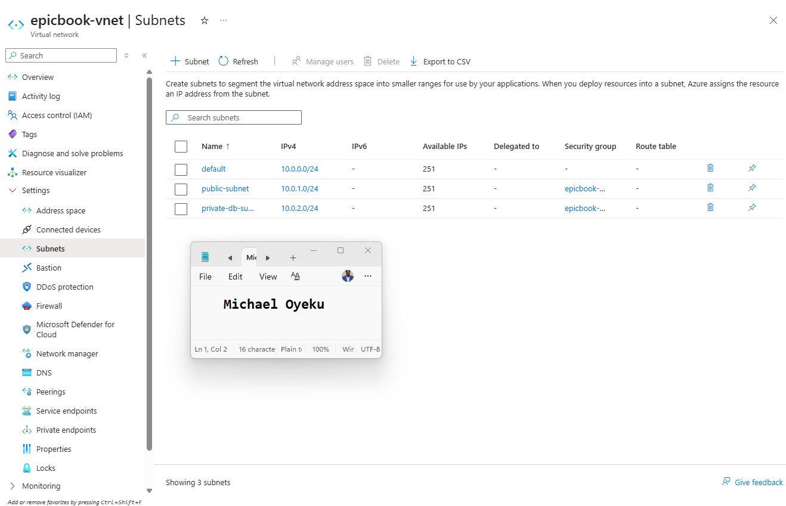

#### Screenshot 2 — Public and private NSG inbound rules showing ports 80, 22, and restricted 3306 access

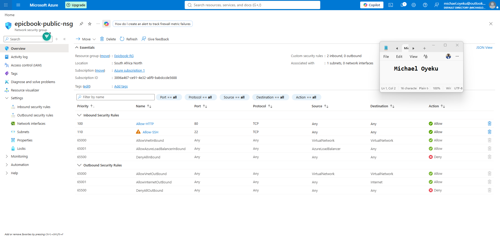

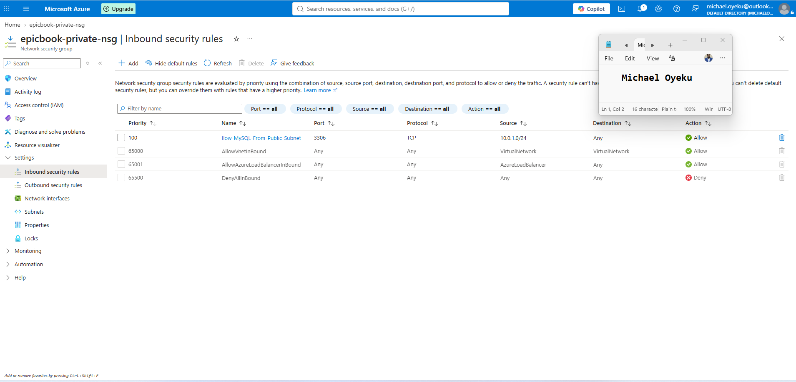

#### Screenshot 3 — Public IP and Network Interface association for the Virtual Machine

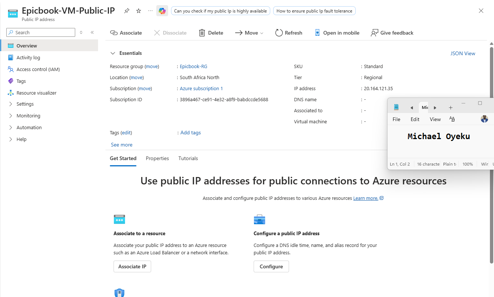

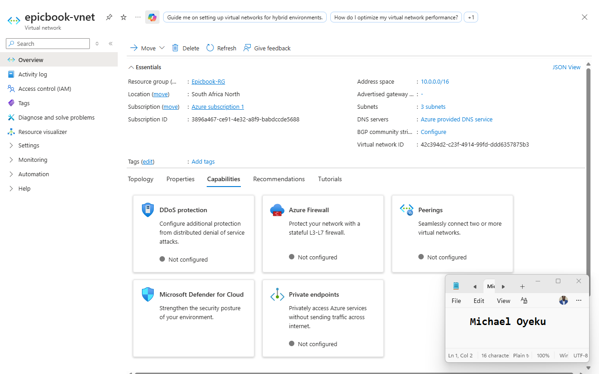

# Task 2 — Provision Azure Virtual Machine

## Goal

Launch an Ubuntu 22.04 LTS VM (Standard B1s or equivalent) in the public subnet, and install Node.js, npm, Nginx, Git, and MySQL Client.

### Evidence

#### Screenshot 4 — Virtual Machine overview showing Ubuntu, size, public IP, and subnet

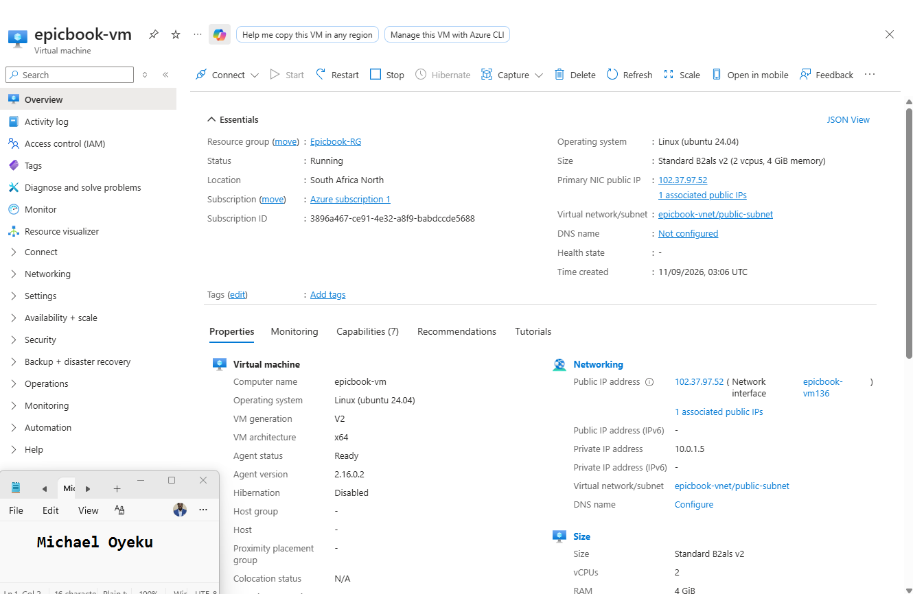

#### Screenshot 5 — Terminal showing successful software installation or installed-version checks

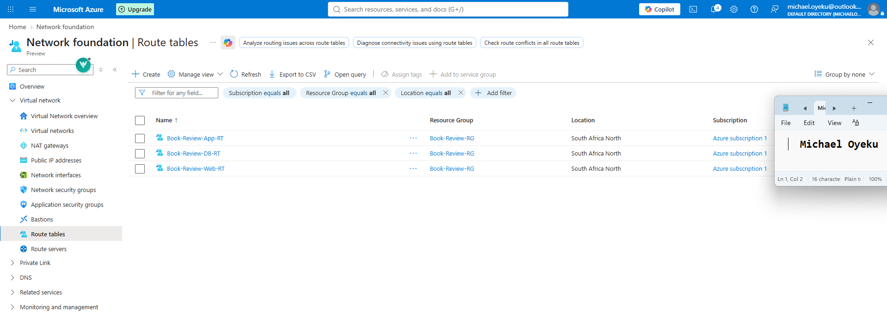

# Task 3 — Deploy the EpicBook Application

## Goal

Clone the EpicBook repository, install dependencies, build the frontend, configure Nginx to serve it, and configure the Node.js/Express.js backend to connect to MySQL using environment variables.

### Evidence

#### Screenshot 6 — Terminal showing the EpicBook repository cloned and dependencies installed

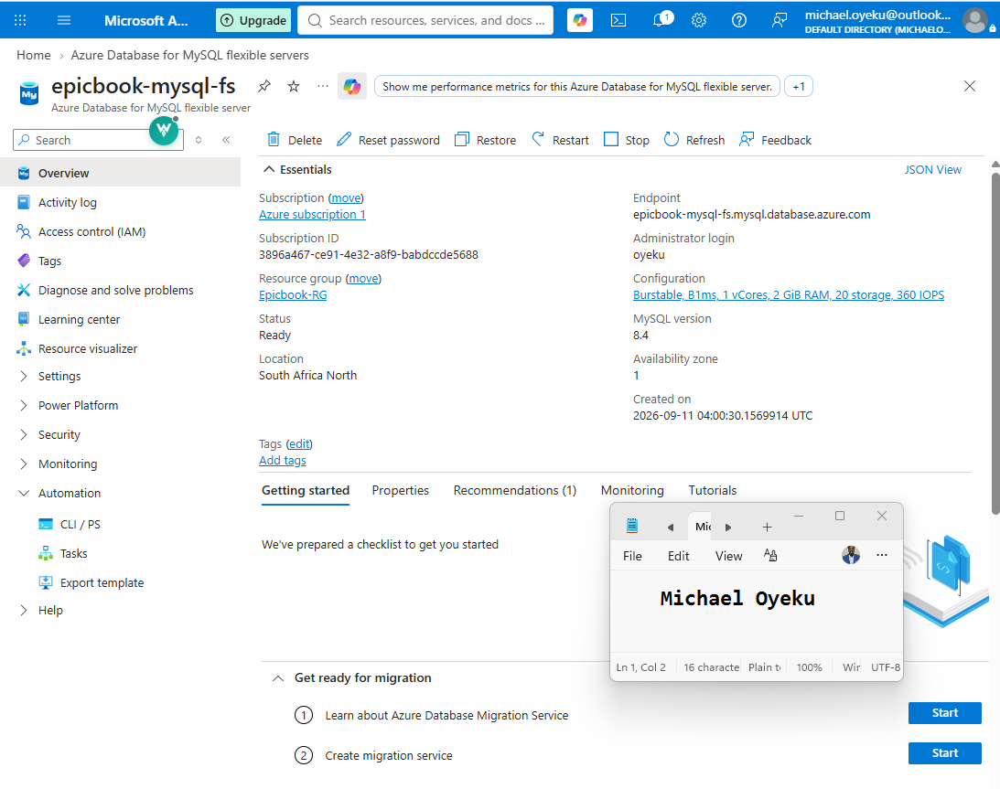

#### Screenshot 7 — Nginx configuration or service status proving the frontend is configured to be served

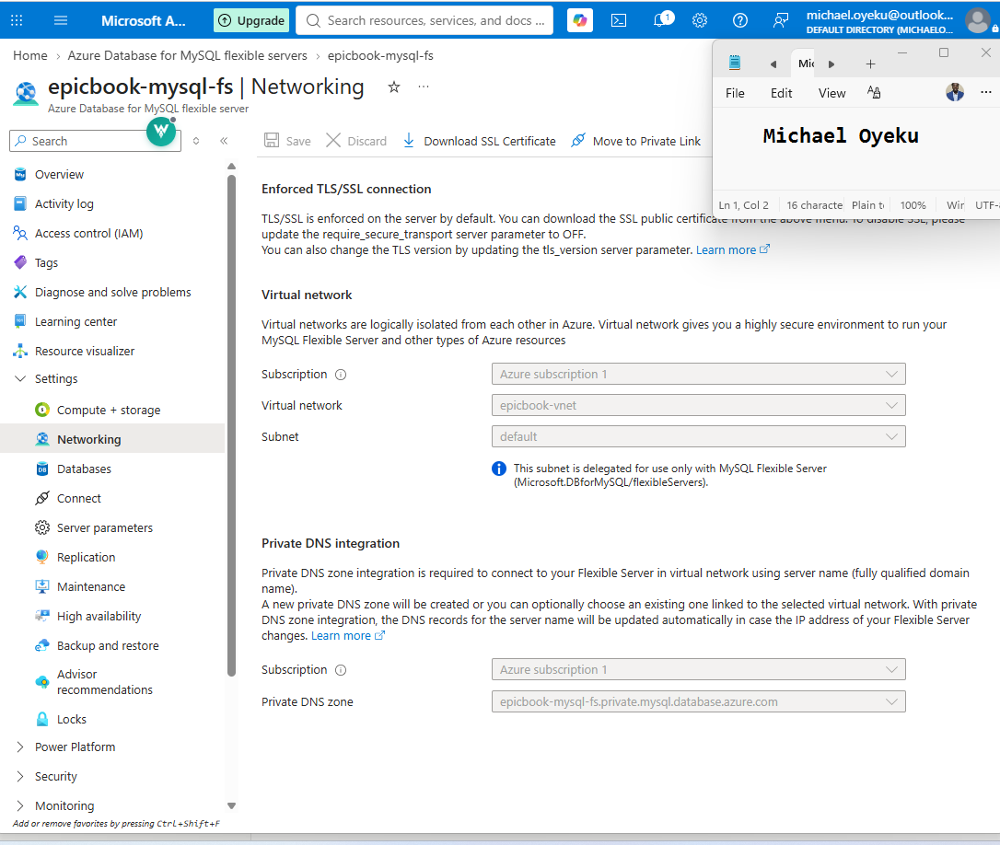

#### Screenshot 8 — Backend process or listening-port evidence (without exposing environment-variable secrets)

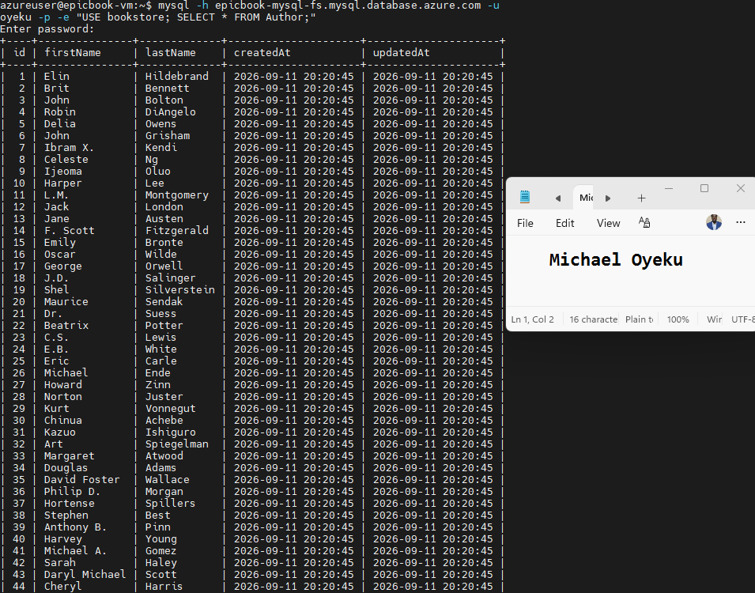

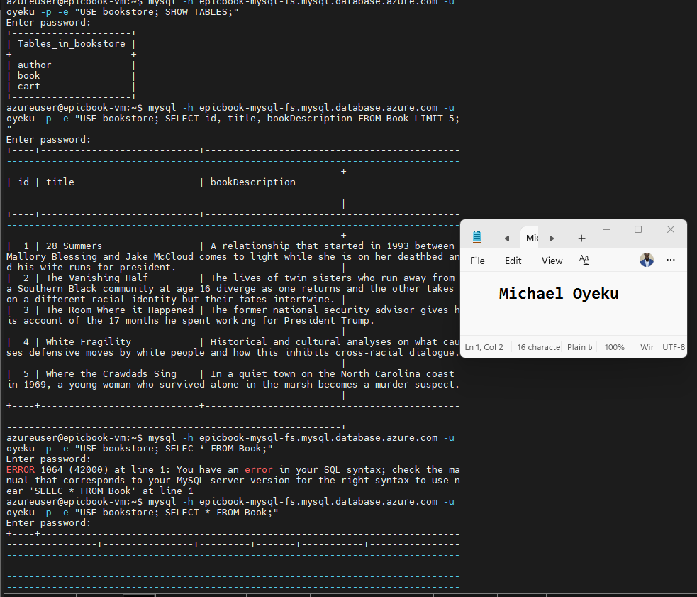

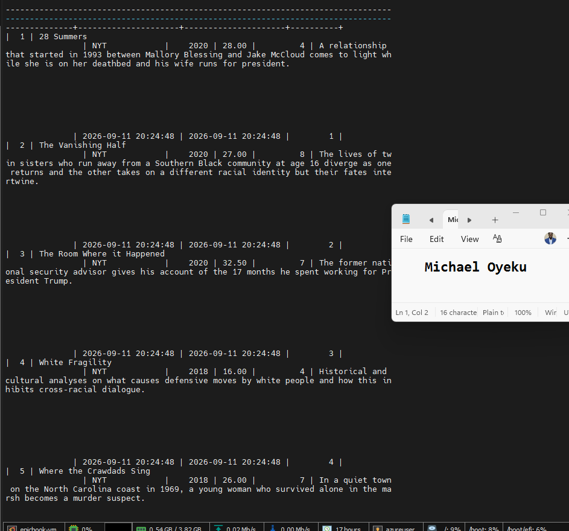

# Task 4 — Setup Azure Database for MySQL

## Goal

Create a private Azure Database for MySQL Flexible Server (VNet Integration) in the private subnet, create the database user and schema, import the SQL dump, and restrict access to the VM subnet only.

### Evidence

#### Screenshot 9 — MySQL Flexible Server overview showing Private access (VNet Integration)

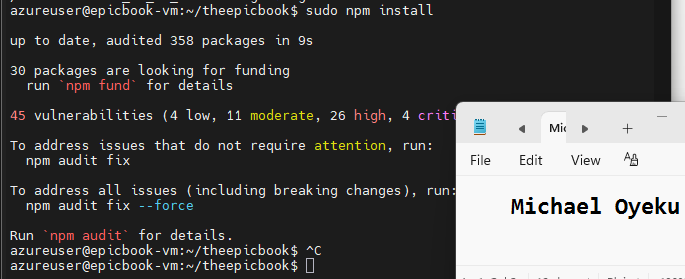

#### Screenshot 10 — Networking configuration showing the private subnet and restricted access

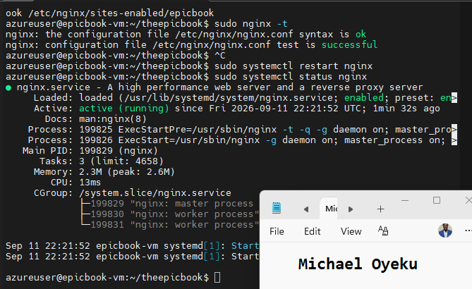

#### Screenshot 11 — MySQL Client output showing the EpicBook database or imported tables (no password visible)

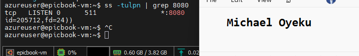
=======
Create a Resource Group and VNet (`10.0.0.0/16`) with `public-subnet` (`10.0.1.0/24`) for the VM and a delegated `private-db-subnet` (`10.0.2.0/24`) for MySQL. Configure and associate the public and private NSGs with the required HTTP, SSH, and MySQL rules.

## Evidence

#### Screenshot 1 — Virtual Network configuration showing the `10.0.0.0/16` address space and both subnets

Add your screenshot here.

---

#### Screenshot 2 — Public and private NSG inbound rules showing HTTP 80, SSH 22, and the MySQL 3306 rule with source `10.0.1.0/24`

Add your screenshot here.

---

# Task 2 — Create and Prepare the Azure Virtual Machine

## Goal

Deploy a supported Ubuntu LTS VM in `public-subnet`, allowing Azure to create its NIC and Public IP. Connect using SSH and install Node.js, npm, Nginx, Git, MySQL Client, and curl.

## Evidence

#### Screenshot 3 — VM Network Interface configuration showing its association with the public subnet and Public IP

Add your screenshot here.

---

#### Screenshot 4 — Virtual Machine overview showing the Ubuntu VM, VM size, Public IP address, and subnet

Add your screenshot here.

---

#### Screenshot 5 — Terminal showing successful installation or version checks for Node.js, npm, Nginx, Git, and MySQL Client

Add your screenshot here.

---

# Task 3 — Configure Azure Database for MySQL and Prepare the EpicBook Database

## Goal

Create Azure Database for MySQL Flexible Server using Private access (VNet Integration) in the delegated database subnet. Clone the EpicBook repository to the VM, create `bookstore`, import the schema and seed data, and verify the database contents.

## Evidence

#### Screenshot 6 — MySQL Flexible Server overview showing the server running and configured with private access

Add your screenshot here.

---

#### Screenshot 7 — MySQL networking configuration showing the server connected to the private database subnet

Add your screenshot here.

---

#### Screenshot 8 — VM terminal showing the `bookstore` database tables and seeded author and book records

Add your screenshot here.

---

# Task 4 — Deploy and Configure the EpicBook Application

## Goal

Install the EpicBook dependencies, configure `config/config.json` with the Azure MySQL connection details, and configure Nginx to proxy HTTP traffic from port 80 to the Node.js application on port 8080.

## Evidence

#### Screenshot 9 — Terminal showing the EpicBook repository, successful dependency installation, and the `node_modules` folder

Add your screenshot here.

---

#### Screenshot 10 — EpicBook Nginx configuration showing `proxy_pass http://127.0.0.1:8080`, or successful `sudo nginx -t` output and active Nginx service status

Add your screenshot here.

---

#### Screenshot 11 — Terminal showing the EpicBook application running and listening on port 8080

Add your screenshot here.

---
>>>>>>> upstream/main

# Task 5 — Test End-to-End Functionality

## Goal

<<<<<<< HEAD
Confirm the EpicBook application loads through the VM's public IP and that viewing products, adding items to the cart, and placing orders all work.

### Evidence

#### Screenshot 12 — Browser showing the EpicBook application with the Virtual Machine public IP visible

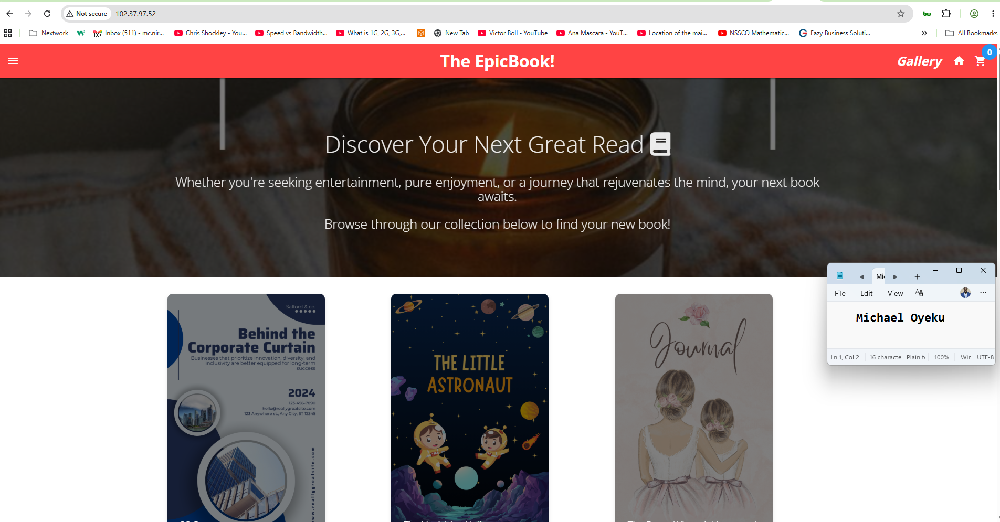

#### Screenshot 13 — Proof of a successful database-backed action (viewing products, adding to cart, or placing an order)

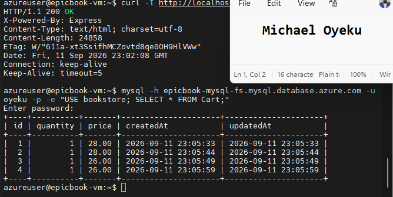

#### Public IP URL

Paste the public IP URL of your Virtual Machine here:
=======
Verify that EpicBook loads through the VM’s public IP, displays products, supports cart operations and checkout, and records the corresponding changes in Azure Database for MySQL.

## Evidence

#### Screenshot 12 — Browser showing EpicBook with the Virtual Machine public IP visible in the address bar

Add your screenshot here.

---

#### Screenshot 13 — Proof of a successful cart or order action together with the corresponding database verification

Add your screenshot here.

---

#### Public IP URL

Paste your working website URL here:

`http://<VM-PUBLIC-IP>`

---

# Configure PM2 for Application Persistence

## Goal

Run EpicBook in the background using PM2, configure startup after a VM reboot, save the process list, and verify that the application remains accessible through Nginx.

## Evidence

#### Screenshot 14 — Terminal showing the `epicbook` process with status `online` in `pm2 list`

Add your screenshot here.

---

# LinkedIn Post (Required)

## Goal

Publish a LinkedIn post with an EpicBook application screenshot, your website URL, and a caption explaining what you deployed, what you learned, a challenge you resolved, and how you verified application actions in the database.

Include **#DMIByPravinMishra #Azure #DevOps #CloudComputing**. Add the credit note and tags for your track as specified in the assignment guidelines.

## Evidence

#### LinkedIn Post URL

Paste your published LinkedIn post URL here:
>>>>>>> upstream/main

`Add your URL here`

---

<<<<<<< HEAD
# Submission Instructions

- Add all required screenshots in your submission
- Include the Virtual Machine public IP URL
- Do not expose database passwords, connection strings, or subscription IDs
=======
#### Screenshot 15 — Published LinkedIn post showing your caption, website URL, and EpicBook application screenshot

Add your screenshot here.

---

# Submission Instructions

- Include your full name and Screenshots **1–15** under the corresponding evidence headings.
- Include the working **Virtual Machine public IP URL** and published **LinkedIn post URL**.
- Add brief notes describing your network, VM, application, and database configuration.
- Include proof of product viewing, cart operations, and order placement.
- Ensure screenshots are readable and show your own environment.
- Do not expose database passwords, private keys, connection strings containing credentials, subscription IDs, or other sensitive information.
- Submit your work using the method specified in the assignment guidelines.
>>>>>>> upstream/main

---

# Completion Checklist

<<<<<<< HEAD
- [ ] Task 1: Network foundation created with public/private subnets and NSGs (Screenshots 1–3)
- [ ] Task 2: VM provisioned and required software installed (Screenshots 4–5)
- [ ] Task 3: EpicBook frontend and backend deployed (Screenshots 6–8)
- [ ] Task 4: Private Azure Database for MySQL created and data imported (Screenshots 9–11)
- [ ] Task 5: End-to-end functionality validated (Screenshots 12–13, Public IP URL)
- [ ] No sensitive data exposed
=======
- [ ] Task 1: Resource Group, VNet, subnets, and NSGs created (Screenshots 1–2)
- [ ] Task 2: VM deployed with NIC and Public IP, and required software installed (Screenshots 3–5)
- [ ] Task 3: Private MySQL server configured, `bookstore` created, and schema and seed data imported (Screenshots 6–8)
- [ ] Task 4: EpicBook configured and running behind Nginx (Screenshots 9–11)
- [ ] Task 5: Product viewing, cart operations, checkout, and database changes verified (Screenshots 12–13)
- [ ] PM2 configured, startup command completed, and process list saved (Screenshot 14)
- [ ] Application remains accessible through Nginx while running under PM2
- [ ] LinkedIn post published with the required hashtags, credit note, and tags (Screenshot 15)
- [ ] Full name, working website URL, and LinkedIn post URL included
- [ ] Brief configuration notes included
- [ ] All screenshots readable and no sensitive information exposed
>>>>>>> upstream/main

---

## 📌 About DMI & CloudAdvisory

DevOps Micro Internship (DMI) is a project-based DevOps program run by Pravin Mishra (The CloudAdvisory) focused on real-world execution, systems thinking, and career readiness.

It helps learners build strong DevOps foundations with hands-on experience.

---

## 📌 Resources

- 🌐 DMI Official Website: https://dmi.pravinmishra.com?utm_source=github&utm_medium=readme  
- 🎓 University: https://university.pravinmishra.com?utm_source=github&utm_medium=readme  
- 💬 Discord Community: https://discord.pravinmishra.com?utm_source=github&utm_medium=readme  
- 📝 Blog: https://dmi.pravinmishra.com/blog?utm_source=github&utm_medium=readme  
- ▶️ YouTube Playlist: https://www.youtube.com/playlist?list=PLFeSNDtI4Cho  
- 🔗 Pravin Mishra (LinkedIn): https://www.linkedin.com/in/pravin-mishra-aws-trainer/  
- 🏢 CloudAdvisory (LinkedIn): https://www.linkedin.com/company/thecloudadvisory/

---

<<<<<<< HEAD
*This submission is part of DevOps Micro Internship (DMI) Cohort 3 — Agentic AI Track.*
=======
*This submission is part of DevOps Micro Internship (DMI) — Agentic AI Track.*
>>>>>>> upstream/main
