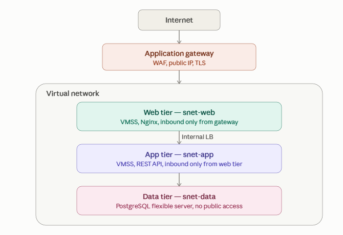
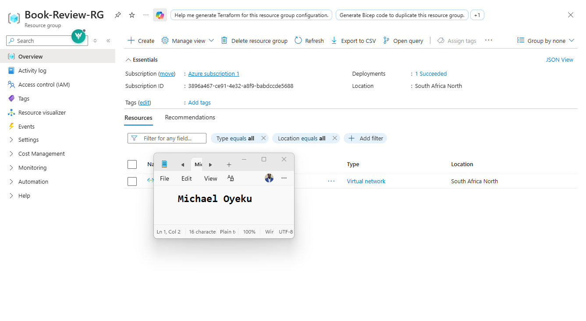
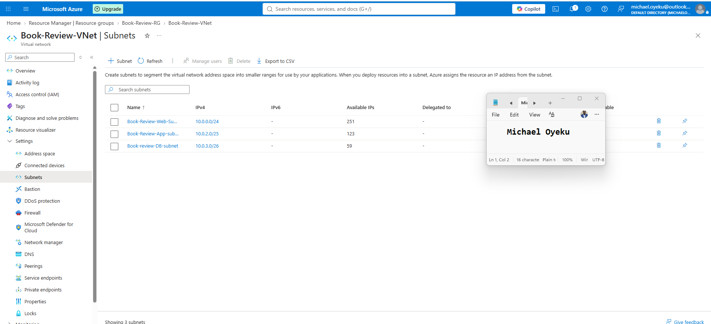
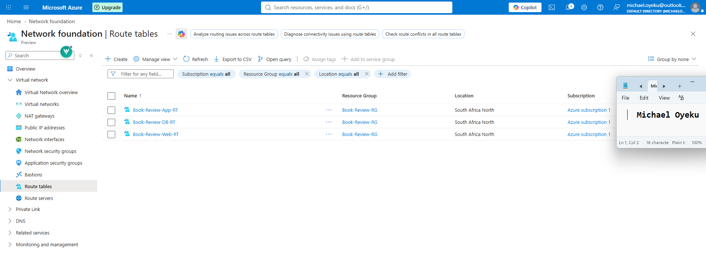
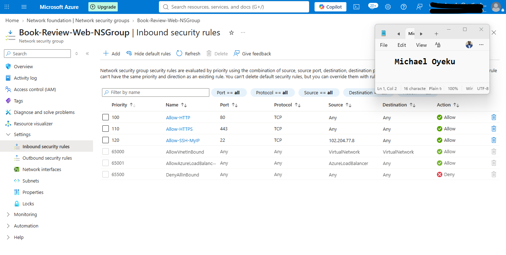
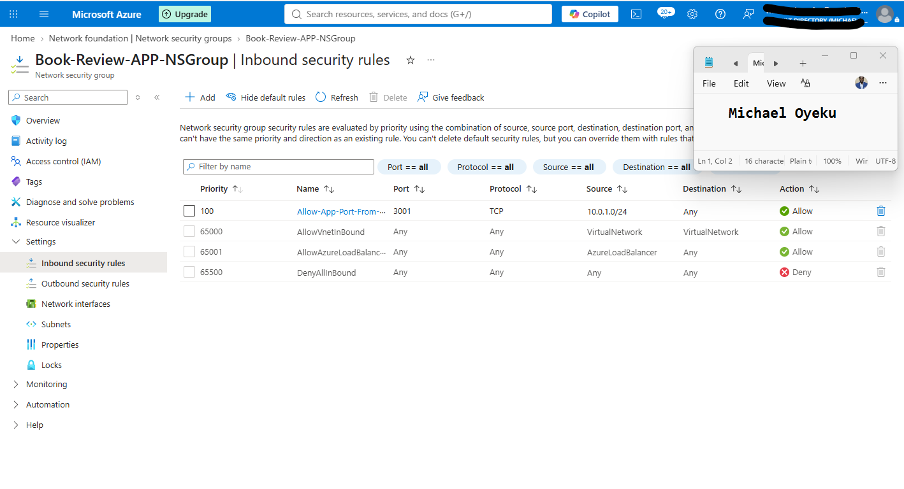
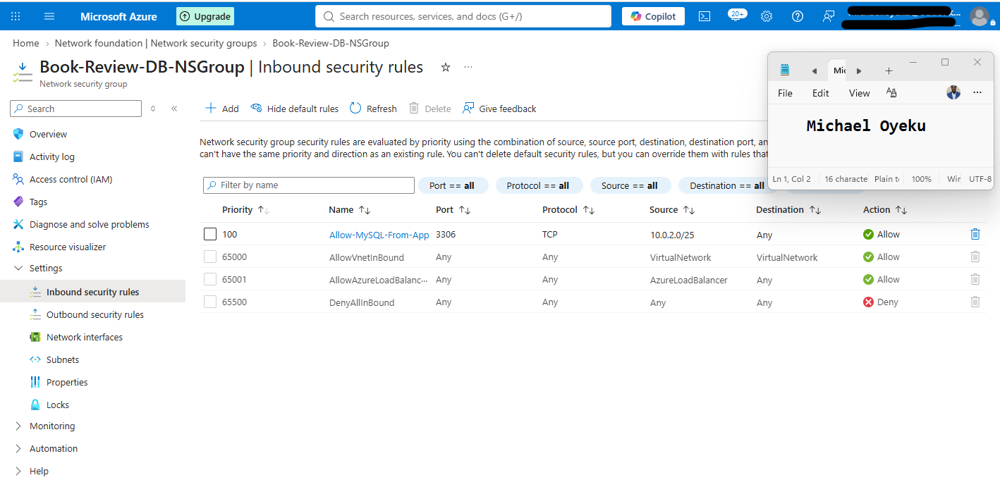
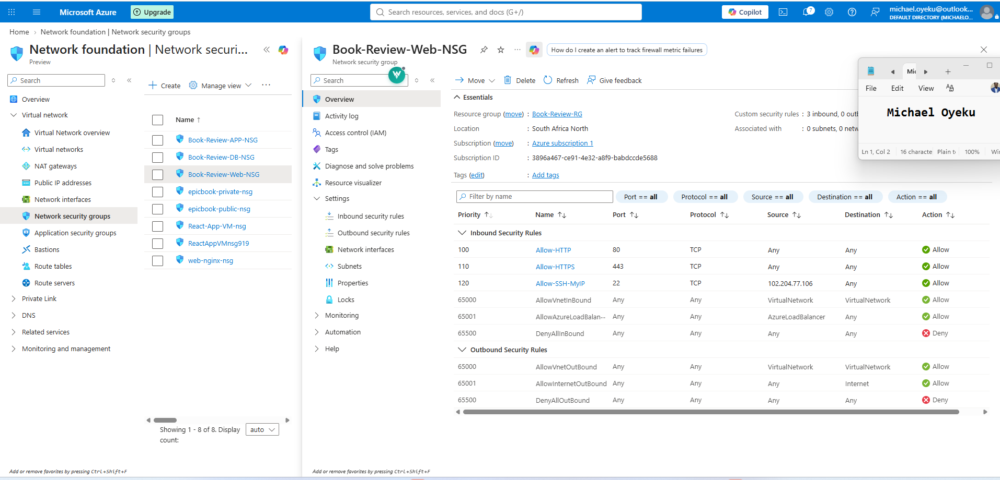

# Assignment 6 — Capstone: Deploy Book Review App (Three-Tier Architecture) on Azure

<<<<<<< HEAD
Part of the DevOps Micro Internship (DMI) Cohort 3 with Agentic AI
=======
Part of the DevOps Micro Internship (DMI) with Agentic AI
>>>>>>> upstream/main

---

## Purpose

<<<<<<< HEAD
This is the most important assignment of the course. You will deploy the Book Review App in a production-ready, best-practice-compliant three-tier architecture on Azure: separated presentation, application, and database tiers, least-privilege network access, a controlled public entry point, protected secrets, and availability/monitoring evidence.
=======
Deploy the Book Review App in a production-style three-tier architecture on Azure, with private application and database tiers, public and internal Load Balancers, protected secrets, monitoring, and restart-recovery testing.
>>>>>>> upstream/main

---

# Task 1 — Design the Azure Three-Tier Architecture

## Goal

<<<<<<< HEAD
Create an architecture diagram and implementation plan identifying the presentation, application, and database components, the chosen Azure services, the public entry point, and the internal traffic paths.

### Evidence

#### Screenshot 1 — Architecture diagram showing the public entry point, three tiers, network boundaries, and traffic flow

#### Screenshot 2 — Written architecture assumptions and selected Azure services

=======
Create an architecture diagram and implementation plan showing the selected Azure services, subnet ranges, application ports, administration path, and traffic flow.

## Evidence

#### Screenshot 1 — Architecture diagram showing the public entry point, three tiers, network boundaries, and traffic flow

Add your screenshot here.

---

#### Architecture Notes

Explain your selected region, VM sizes, database capacity, secret-management method, monitoring, backup, and recovery choices. State that one VM per compute tier allows downtime during a restart or failure.

Write your answer here.

---
>>>>>>> upstream/main

# Task 2 — Create the Azure Network Foundation

## Goal

<<<<<<< HEAD
Create a dedicated Resource Group and VNet with separate subnets for the web, application, and database tiers, keeping the application and database tiers without direct public access.

### Evidence

#### Screenshot 3 — Resource Group overview showing the assignment resources

#### Screenshot 4 — VNet overview showing the address space and all required subnets

#### Screenshot 5 — Route-table or Private DNS evidence where applicable

=======
Create a Resource Group and VNet using `10.0.0.0/16`, with web subnet `10.0.1.0/24`, application subnet `10.0.2.0/25`, and delegated database subnet `10.0.3.0/26`. Associate a NAT Gateway with the web and application subnets and reserve a private frontend IP for the Internal Load Balancer.

## Evidence

#### Screenshot 2 — Resource Group overview showing the network resources created so far

Add your screenshot here.

---

#### Screenshot 3 — VNet subnet configuration showing all three subnet names, CIDR ranges, and database subnet delegation

Add your screenshot here.

---

#### Screenshot 4 — NAT Gateway configuration showing its Public IP and associations with the web and application subnets

Add your screenshot here.

---
>>>>>>> upstream/main

# Task 3 — Configure Security and Secret Management

## Goal

<<<<<<< HEAD
Apply least-privilege NSG rules so traffic flows Internet → public entry point → web tier → application tier → database tier, and store credentials in Azure Key Vault or another approved secure mechanism.

### Evidence

#### Screenshot 6 — NSG rules proving least-privilege access between the tiers

#### Screenshot 7 — Key Vault or approved secret-management configuration (without displaying secret values)

# Task 4 — Deploy the Presentation (Web) Tier

## Goal

Deploy the Book Review App presentation layer on the approved web-tier compute service, configured to route requests to the internal application-tier endpoint, and not directly exposed except through the public entry service.

### Evidence

#### Screenshot 8 — Web-tier compute overview showing subnet and availability configuration

#### Screenshot 9 — Terminal or service output proving the presentation layer is running

# Task 5 — Deploy the Business (Application) Tier

## Goal

Deploy the Book Review App backend privately in the application subnet, configured to use the private database endpoint and secured environment values, reachable only through its internal endpoint.

### Evidence

#### Screenshot 10 — Application-tier compute overview showing private subnet placement
=======
Configure NSGs for application, management, and health-probe traffic. Protect database credentials and the JWT signing secret. Create the Web VM with restricted SSH access and use it as the jump host for private App VM administration.

## Evidence

#### Screenshot 5 — Web, application, and database NSG rules showing permitted sources, ports, health-probe access, and applicable deny rules

Add your screenshot here.

---

#### Screenshot 6 — Key Vault or the selected secret-management configuration, without displaying secret values

Add your screenshot here.

---

# Task 4 — Deploy the Managed Database Tier

## Goal

Create Azure Database for MySQL Flexible Server using private access in the delegated database subnet. Configure Private DNS, keep secure transport enabled, disable public access, and document backup and availability settings.

## Evidence

#### Screenshot 7 — MySQL Flexible Server networking configuration showing the private subnet and Private DNS configuration

Add your screenshot here.

---

#### Screenshot 8 — Database backup-retention and availability settings

Add your screenshot here.

---

#### Database Notes

Record the database service, selected capacity, backup-retention period, and recovery approach. Do not include passwords.

Write your answer here.

---

# Task 5 — Deploy the Business or Application Tier

## Goal

Deploy the backend on one private Ubuntu VM using port **3001**. Connect to Azure MySQL over TLS, create `book_review_db` and the application database user, verify startup schema and sample-data initialization, and configure PM2 for automatic recovery.

## Evidence

#### Screenshot 9 — App VM networking configuration showing placement in the application subnet and no Public IP
>>>>>>> upstream/main

Add your screenshot here.

---

<<<<<<< HEAD
#### Screenshot 11 — Backend process, service, or listening-port evidence
=======
#### Screenshot 10 — Successful database connection and schema verification from the App VM, without displaying credentials
>>>>>>> upstream/main

Add your screenshot here.

---

<<<<<<< HEAD
#### Screenshot 12 — Internal health-check or API response (without exposing secrets)
=======
#### Screenshot 11 — PM2 showing `book-review-backend` online after reboot
>>>>>>> upstream/main

Add your screenshot here.

---

<<<<<<< HEAD
# Task 6 — Deploy the Managed Database Tier

## Goal

Create a private Azure managed database (public access disabled), with availability/backup/retention settings, the Book Review App schema imported, and access restricted to the application tier only.

### Evidence

#### Screenshot 13 — Database overview showing private connectivity and public access disabled
=======
#### Screenshot 12 — Successful backend health or API response from the Web VM through the App VM’s private IP

Add your screenshot here.

---

# Task 6 — Deploy the Presentation or Web Tier

## Goal

Deploy the Next.js frontend on the existing Web VM on port **3000**. Configure Nginx on port **80** to forward page requests to the frontend and `/api/` requests to the Internal Load Balancer on port **3001**. Configure PM2 and verify recovery after reboot.

## Evidence

#### Screenshot 13 — Web VM overview or networking configuration showing its subnet and VM details
>>>>>>> upstream/main

Add your screenshot here.

---

<<<<<<< HEAD
#### Screenshot 14 — Availability, backup, and retention configuration
=======
#### Screenshot 14 — Nginx site configuration showing frontend and API routing, together with successful `sudo nginx -t` output
>>>>>>> upstream/main

Add your screenshot here.

---

<<<<<<< HEAD
#### Screenshot 15 — Successful schema or connectivity verification (without exposing credentials)
=======
#### Screenshot 15 — PM2 showing `book-review-frontend` online after reboot, with Nginx active and a successful local HTTP response
>>>>>>> upstream/main

Add your screenshot here.

---

<<<<<<< HEAD
# Task 7 — Configure Traffic Management, Availability, and Monitoring

## Goal

Configure the approved public entry service with health probes and backend pools, internal routing for the application tier where required, and enable Azure Monitor/diagnostics/logs/alerts for the key resources.

### Evidence

#### Screenshot 16 — Public entry service showing listener, frontend endpoint, and healthy web targets
=======
# Task 7 — Configure Load Balancers, Health Checks, and Monitoring

## Goal

Configure a Standard Public Load Balancer using TCP **80 → 80** and a Standard Internal Load Balancer using TCP **3001 → 3001**. Verify backend health, update the allowed frontend origin, and configure monitoring and at least one alert rule.

## Evidence

#### Screenshot 16 — Public Load Balancer frontend IP, web backend membership, TCP 80 → 80 rule, and health-probe status
>>>>>>> upstream/main

Add your screenshot here.

---

<<<<<<< HEAD
#### Screenshot 17 — Internal application-tier load-balancing or routing configuration where applicable
=======
#### Screenshot 17 — Internal Load Balancer private frontend IP, application backend membership, TCP 3001 → 3001 rule, and health-probe status
>>>>>>> upstream/main

Add your screenshot here.

---

<<<<<<< HEAD
#### Screenshot 18 — Azure Monitor, diagnostic settings, logs, metrics, or alert evidence
=======
#### Screenshot 18 — Monitoring evidence showing a relevant metric or collected log and the configured alert rule
>>>>>>> upstream/main

Add your screenshot here.

---

# Task 8 — Validate the Production-Style Deployment

## Goal

<<<<<<< HEAD
Confirm the Book Review App works end to end through the public endpoint, with at least one database read and one write, confirm private tiers are not internet-reachable, and complete a safe availability test.

### Evidence

#### Screenshot 19 — Browser showing the Book Review App through the public endpoint
=======
Verify registration, login, book viewing, and persistent review creation through the Public Load Balancer. Confirm private-tier restrictions and automatic service recovery after controlled App VM and Web VM restarts. Downtime is expected during these single-instance restart tests.

## Evidence

#### Screenshot 19 — Browser showing the Book Review App through the Public Load Balancer endpoint, with the address bar visible
>>>>>>> upstream/main

Add your screenshot here.

---

<<<<<<< HEAD
#### Screenshot 20 — Proof of successful database-backed read and write operations
=======
#### Screenshot 20 — Successful registration/login, book viewing, and review creation, with database evidence that the review persists
>>>>>>> upstream/main

Add your screenshot here.

---

<<<<<<< HEAD
#### Screenshot 21 — Evidence that private tiers are not publicly accessible
=======
#### Screenshot 21 — App VM networking showing no Public IP, MySQL private-access settings, and relevant NSG restrictions
>>>>>>> upstream/main

Add your screenshot here.

---

<<<<<<< HEAD
#### Screenshot 22 — Availability-test and healthy-target evidence
=======
#### Screenshot 22 — Post-restart PM2/service status, healthy Load Balancer backends, and a successful application response
>>>>>>> upstream/main

Add your screenshot here.

---

#### Public Endpoint

<<<<<<< HEAD
Paste your public endpoint URL here:

`Add your URL here`

---

### Notes

Summarize what worked, issues encountered and how they were fixed, and the availability/security/secrets/monitoring/backup choices made.
=======
Paste your Public Load Balancer website URL here:

`http://<PUBLIC-LB-IP>`

---

#### Recovery Notes

Record which VM was restarted, the observed interruption, recovery time, and whether services recovered without manual startup.
>>>>>>> upstream/main

Write your answer here.

---

<<<<<<< HEAD
# Submission Instructions

- Add all required screenshots and links in your submission
- Do not expose passwords, keys, connection strings, or subscription IDs
=======
#### Deployment Notes

Summarize what worked, issues encountered, fixes applied, and sources used. Identify the backend route used for direct and Internal Load Balancer verification, including its expected response.

Write your answer here.

---

# LinkedIn Post (Required)

## Goal

Publish a LinkedIn post with an application screenshot, your public website URL, and a caption explaining what you deployed, what you learned, one challenge you resolved, and how you verified database-backed functionality and recovery after VM restarts.

Include **#DMIByPravinMishra #Azure #DevOps #CloudComputing**. Add the credit note and tags for your track as specified in the assignment guidelines.

## Evidence

#### LinkedIn Post URL

Paste your published LinkedIn post URL here:

`Add your URL here`

---

#### Screenshot 23 — Published LinkedIn post showing your caption, website URL, and application screenshot

Add your screenshot here.

---

# Submission Instructions

- Include your full name and Screenshots **1–23** under the corresponding evidence headings.
- Use multiple captures under an evidence heading where needed for readability.
- Include the working **public endpoint URL** and published **LinkedIn post URL**.
- Complete the architecture, database, recovery, and deployment notes.
- Ensure screenshots are readable and show your own environment.
- Do not expose passwords, private keys, tokens, connection strings containing credentials, subscription IDs, or other sensitive information.
- Submit your work using the method specified in the assignment guidelines.
>>>>>>> upstream/main

---

# Completion Checklist

<<<<<<< HEAD
- [ ] Task 1: Architecture diagram and assumptions documented (Screenshots 1–2)
- [ ] Task 2: Network foundation created with isolated tiers (Screenshots 3–5)
- [ ] Task 3: Least-privilege security and secret management configured (Screenshots 6–7)
- [ ] Task 4: Presentation tier deployed (Screenshots 8–9)
- [ ] Task 5: Application tier deployed privately (Screenshots 10–12)
- [ ] Task 6: Managed database tier deployed privately (Screenshots 13–15)
- [ ] Task 7: Public entry, internal routing, and monitoring configured (Screenshots 16–18)
- [ ] Task 8: End-to-end validation and availability test completed (Screenshots 19–22, Public Endpoint, Notes)
- [ ] No sensitive data exposed
=======
- [ ] Task 1: Architecture diagram and required notes completed (Screenshot 1)
- [ ] Task 2: VNet, subnets, database delegation, and NAT Gateway configured (Screenshots 2–4)
- [ ] Task 3: NSGs and secret management configured; Web VM created for administration and frontend hosting (Screenshots 5–6)
- [ ] Task 4: Private Azure MySQL server, Private DNS, and backup settings configured (Screenshots 7–8)
- [ ] Task 5: Private backend deployed, database initialized, and PM2 recovery verified (Screenshots 9–12)
- [ ] Task 6: Frontend and Nginx routing configured, with recovery verified (Screenshots 13–15)
- [ ] Task 7: Public and Internal Load Balancers healthy; monitoring and alert configured (Screenshots 16–18)
- [ ] Task 8: Application workflows, private-tier restrictions, and restart recovery verified (Screenshots 19–22)
- [ ] Architecture, database, recovery, and deployment notes completed
- [ ] LinkedIn post published with required hashtags, credit note, and tags (Screenshot 23)
- [ ] Full name, public endpoint URL, and LinkedIn post URL included
- [ ] All screenshots readable and no sensitive information exposed
>>>>>>> upstream/main

---

## 📌 About DMI & CloudAdvisory

DevOps Micro Internship (DMI) is a project-based DevOps program run by Pravin Mishra (The CloudAdvisory) focused on real-world execution, systems thinking, and career readiness.

It helps learners build strong DevOps foundations with hands-on experience.

---

## 📌 Resources

- 🌐 DMI Official Website: https://dmi.pravinmishra.com?utm_source=github&utm_medium=readme  
- 🎓 University: https://university.pravinmishra.com?utm_source=github&utm_medium=readme  
- 💬 Discord Community: https://discord.pravinmishra.com?utm_source=github&utm_medium=readme  
- 📝 Blog: https://dmi.pravinmishra.com/blog?utm_source=github&utm_medium=readme  
- ▶️ YouTube Playlist: https://www.youtube.com/playlist?list=PLFeSNDtI4Cho  
- 🔗 Pravin Mishra (LinkedIn): https://www.linkedin.com/in/pravin-mishra-aws-trainer/  
- 🏢 CloudAdvisory (LinkedIn): https://www.linkedin.com/company/thecloudadvisory/

---

<<<<<<< HEAD
*This submission is part of DevOps Micro Internship (DMI) Cohort 3 — Agentic AI Track.*
=======
*This submission is part of DevOps Micro Internship (DMI) — Agentic AI Track.*
>>>>>>> upstream/main
