# Assignment 7 — Capstone: Deploy a Production-Grade Stack for The EpicBook

Part of the DevOps Micro Internship (DMI) with Agentic AI

---

## Purpose

In this assignment, you will deploy the EpicBook application as a production-oriented Docker Compose stack on a cloud VM. You will use optimized container images, isolated networks, health checks, persistent MySQL storage, a selected reverse proxy, logging, backup and restore testing, and reliability procedures.

---

# Task 0 — App Discovery and Architecture

## Goal

Review the EpicBook repository and design the intended application architecture.

### Evidence

#### Screenshot 1 — EpicBook Project Structure

Add a terminal screenshot showing the EpicBook project structure after cloning the repository.

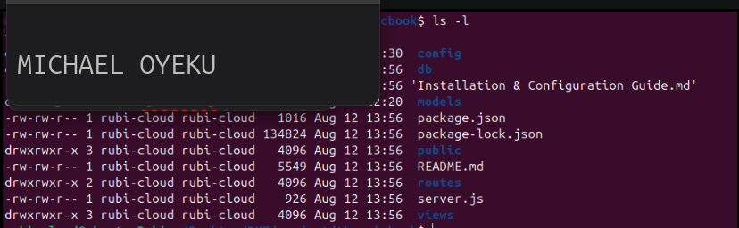

---

#### Screenshot 2 — Architecture Diagram

Add a screenshot of your architecture diagram showing:

- Public user
- Reverse proxy
- Frontend
- Backend
- Database
- Docker networks
- Public and private ports
- Persistent database storage

Add your full name inside the diagram or as a clear caption below it.

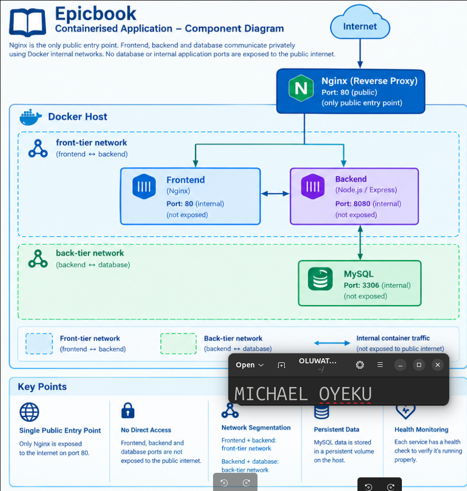

---

#### Screenshot 3 — Environment Variables and Ports Document

Add a screenshot showing the contents of:

```text
docs/02-env-and-ports.md
```

It must document environment-variable names, internal ports, persistent-data details, and the health-check method. Do not expose real credentials or values.

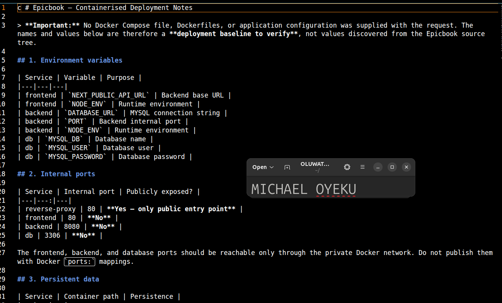

---

# Task 1 — Create Production Docker Images

## Goal

Create optimized production images for the EpicBook backend and frontend.

### Evidence

#### Screenshot 4 — Backend Dockerfile

Add a screenshot showing `backend/Dockerfile`, including:

- Dependency stage
- Minimal runtime stage
- Production startup command
- Internal backend port
- Non-root user configuration

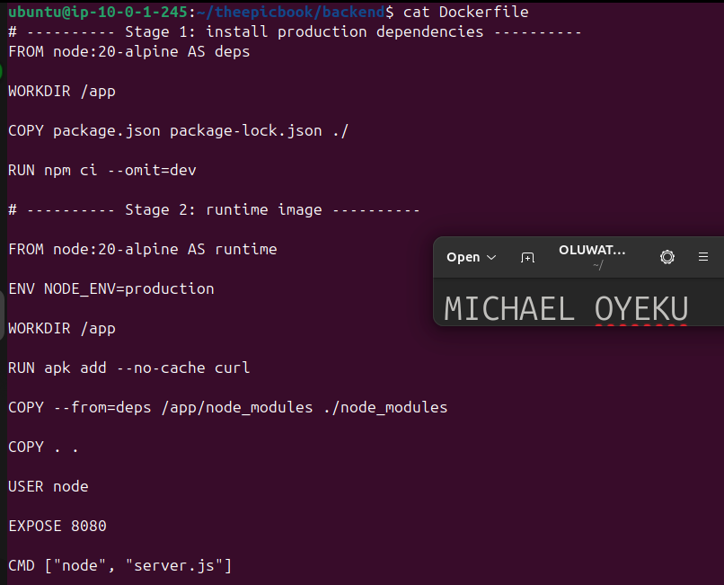

---

#### Screenshot 5 — Frontend Dockerfile

Add a screenshot showing `frontend/Dockerfile`, including:

- Nginx runtime image
- Static frontend files copied to the Nginx web root

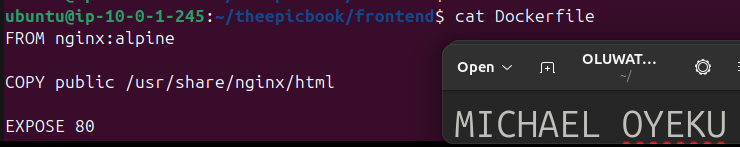

---

#### Screenshot 6 — Docker Ignore Files

Add a screenshot showing both:

```text
backend/.dockerignore
frontend/.dockerignore
```

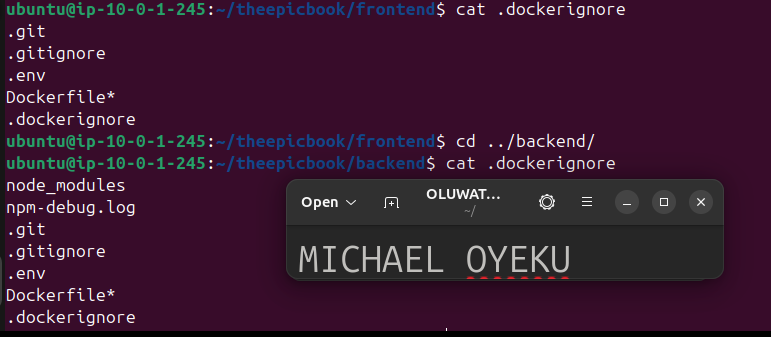

---

#### Screenshot 7 — Docker Image Builds and Size Comparison

Add a terminal screenshot showing successful builds of:

- Baseline backend image
- Optimized backend image
- Frontend image

The screenshot must also show the baseline and optimized backend image-size comparison.

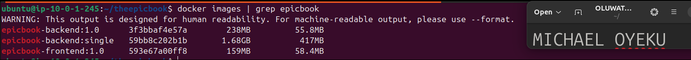

---

#### Screenshot 8 — Backend Running as Non-Root User

Add a terminal screenshot showing the optimized backend container running as a non-root user.

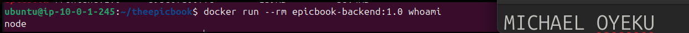

---

### Notes

Write a short note covering:

- Baseline and optimized backend image sizes
- The image-size reduction achieved
- One Docker layer-caching optimization used
- The security benefit of running the backend as a non-root user

Write your note here.

---

# Task 2 — Create the Docker Compose Stack and Networks

## Goal

Create one Docker Compose stack containing the reverse proxy, frontend, backend, and MySQL database.

### Evidence

#### Screenshot 9 — Docker Compose Services

Add a screenshot showing `docker-compose.yml` with all four services:

```text
reverse-proxy
frontend
backend
database
```

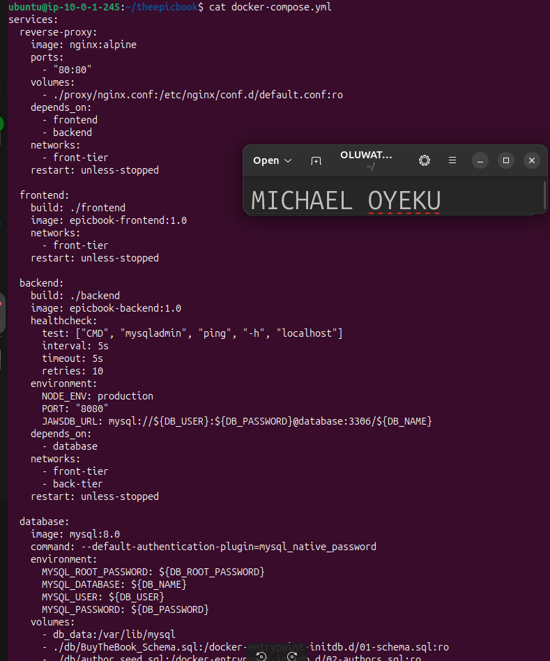

---

#### Screenshot 10 — Networks and Named Volume

Add a screenshot showing:

- `front-tier` network
- `back-tier` network
- `db_data` named volume

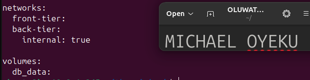

---

#### Screenshot 11 — Docker Compose Validation

Add a terminal screenshot showing successful Docker Compose validation without exposing environment-variable values or secrets.

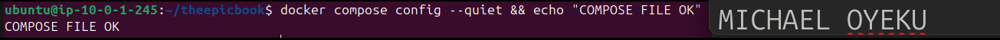

---

# Task 3 — Configure Health Checks and Startup Dependencies

## Goal

Configure health checks and ensure services start only after their dependencies are healthy.

### Evidence

#### Screenshot 12 — Backend Health Endpoint

Add a screenshot showing the backend application configuration for the `/health` endpoint.

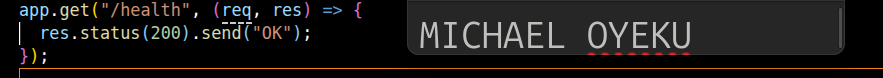

---

#### Screenshot 13 — MySQL and Backend Health Checks

Add a screenshot showing `docker-compose.yml` with health checks for MySQL and the backend.

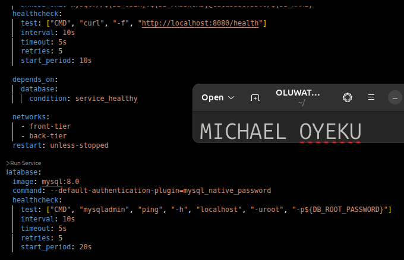

---

#### Screenshot 14 — Frontend and Reverse-Proxy Health Checks

Add a screenshot showing:

- Frontend health check
- Reverse-proxy health check
- `depends_on` conditions using `service_healthy`

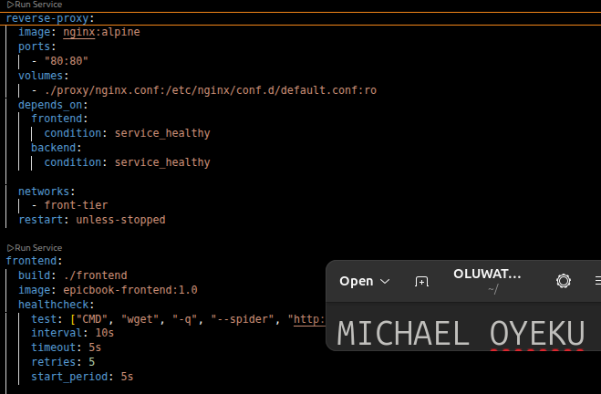

---

#### Screenshot 15 — Running Healthy Services

Add a terminal screenshot showing Docker Compose service status. The database, backend, frontend, and reverse proxy must be running successfully.

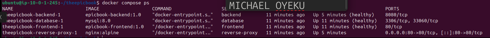

---

#### Screenshot 16 — Public Health Endpoint

Add a terminal screenshot showing a successful response from the public application health endpoint through the reverse proxy.

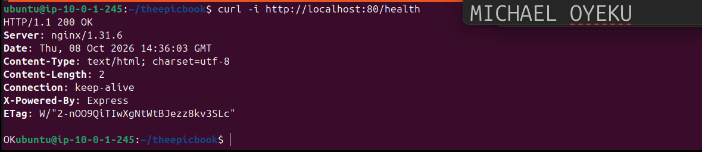

---

#### Screenshot 17 — Health-Check and Startup-Order Document

Add a screenshot showing the contents of:

```text
docs/03-healthchecks-and-depends-on.md
```

Explain the health-check method for each service and the startup dependency order.

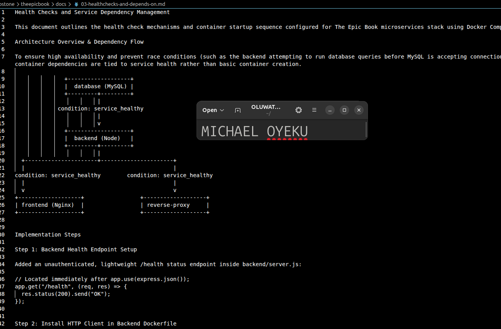

---

# Task 4 — Configure the Reverse Proxy and Same-Origin Routing

## Goal

Use either Nginx or Traefik as the only public entry point for the EpicBook application.

### Evidence

#### Screenshot 18 — Selected Reverse-Proxy Configuration

Add a screenshot showing the configuration for your selected reverse proxy.

It must show routes for:

- Static frontend assets
- Application pages
- API requests
- Health endpoint

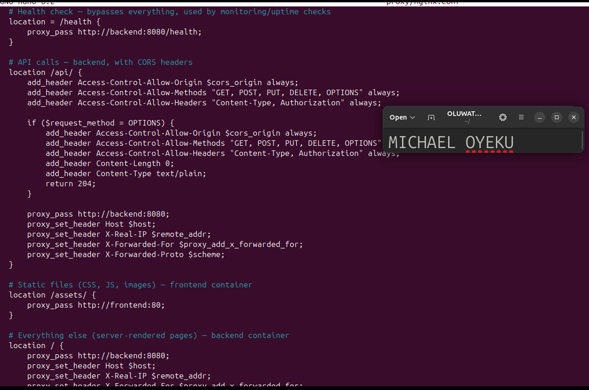

---

#### Screenshot 19 — Only Reverse Proxy Publishes Port 80

Add a screenshot of `docker-compose.yml` showing that only the `reverse-proxy` service publishes port 80.

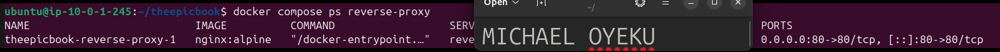

---

#### Screenshot 20 — Reverse-Proxy Route Testing

Add a terminal screenshot showing successful requests through the selected reverse proxy to:

- Application page
- One API endpoint
- One static asset
- Health endpoint

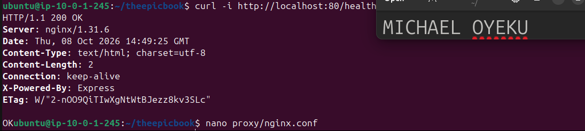

---

#### Screenshot 21 — EpicBook Application Through Public IP

Add a browser screenshot showing the EpicBook application loaded through the VM public IP address.

Add your full name as a clear caption below the screenshot.

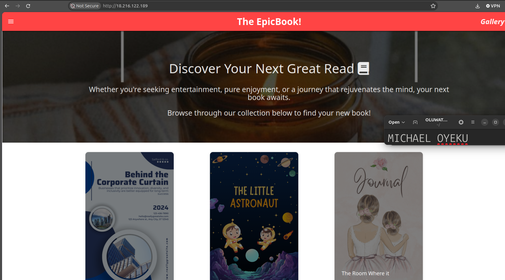

---

#### Screenshot 22 — Proxy Routing and CORS Document

Add a screenshot showing the contents of:

```text
docs/04-proxy-routing-and-cors.md
```

Explain the proxy routes and state whether CORS was required and why.

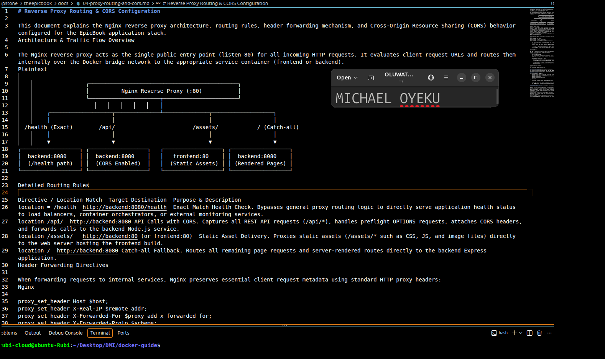

---

# Task 5 — Prove Data Persistence, Backup, and Restore

## Goal

Verify MySQL persistence and perform a controlled backup and restore drill.

### Evidence

#### Screenshot 23 — MySQL Volume Configuration

Add a terminal screenshot showing the `db_data` named volume and its MySQL mount configuration.

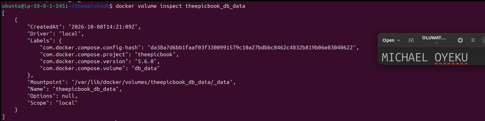

---

#### Screenshot 24 — Test Data Before Backup

Add a terminal screenshot showing the selected test data before the backup and restore drill.

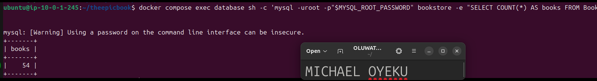

---

#### Screenshot 25 — Successful Backup Creation

Add a terminal screenshot showing successful backup creation and the backup file stored in the host backup directory.

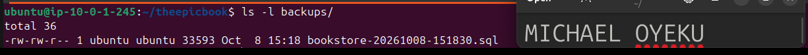

---

#### Screenshot 26 — Controlled Data-Loss Test

Add a terminal screenshot showing that the selected test record was removed during the controlled data-loss test.

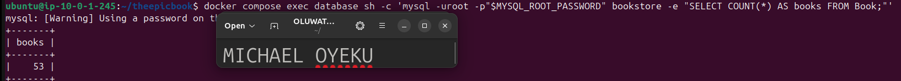

---

#### Screenshot 27 — Restore Verification

Add a terminal screenshot showing successful restore and verification that the deleted test record is available again.

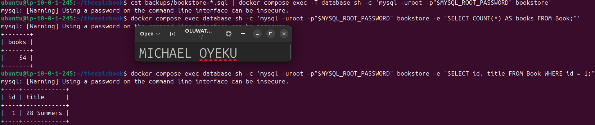

---

#### Screenshot 28 — Persistence After Down/Up Cycle

Add a terminal screenshot showing that database data remains available after a non-destructive Docker Compose down/up cycle.

Do not use `docker compose down -v`.

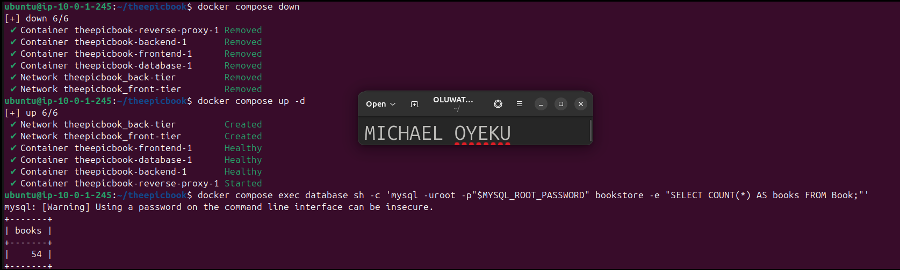

---

#### Screenshot 29 — Persistence and Backup Document

Add a screenshot showing the contents of:

```text
docs/05-persistence-and-backup.md
```

Include the backup plan and restore procedure.

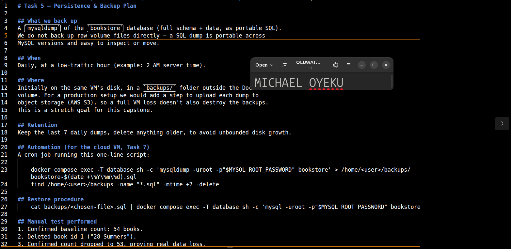

---

# Task 6 — Configure Logging and Observability

## Goal

Configure useful reverse-proxy and backend logs without exposing sensitive information.

### Evidence

#### Screenshot 30 — Logging Configuration

Add a screenshot showing:

- Configuration for the selected reverse proxy
- Proxy log format
- Docker Compose host log-directory bind mount

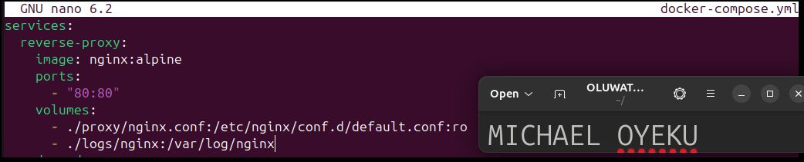

---

#### Screenshot 31 — Persistent Proxy Logs and Backend Logs

Add a terminal screenshot showing:

- Selected reverse-proxy logs available from the host directory after a proxy restart
- Backend logs displayed through Docker Compose

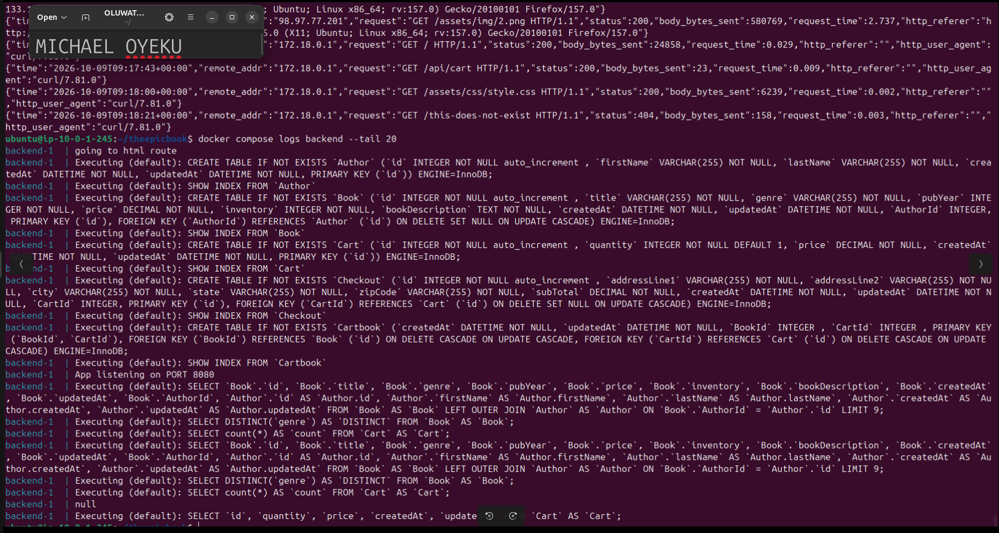

---

### Notes

Write a short note covering:

- The selected reverse proxy
- Host path used for reverse-proxy logs
- How backend logs are viewed
- Whether JSON or standard text logs were used
- Why passwords, tokens, headers, and database connection strings must not appear in logs

Write your note here.

1. Selected Reverse Proxy

The selected reverse proxy for the EpicBook application is Nginx. It serves as the single public entry point, receiving incoming HTTP requests and routing them to the appropriate application services.

2. Host Path Used for Reverse-Proxy Logs

The designated host directory for the EpicBook project is /the epicbook. This directory is intended to provide access to reverse-proxy log files and support log persistence through Docker Compose bind mounts.

3. How Backend Logs Are Viewed

Backend application logs can be monitored using Docker Compose:

docker compose logs -f backend

This command provides continuous visibility into application activities, errors, and other operational events.

Log Format

4. The selected logging format is JSON. JSON provides a structured format that makes log entries easier to read, analyse, filter, and process using automated monitoring tools.

5. Protection of Sensitive Information

Passwords, authentication tokens, request headers containing credentials, and database connection strings must not be exposed in application logs. Logging such information could result in credential leakage, unauthorised access, and other security incidents.

Therefore, logs should contain only the information necessary for monitoring, troubleshooting, and operational analysis.
---

# Task 7 — Deploy and Verify the Stack on a Cloud VM

## Goal

Deploy the completed Docker Compose stack on an AWS or Azure VM and verify public access.

### Evidence

#### Screenshot 32 — VM Public IP and Inbound Rules

Add a cloud-console screenshot showing:

- VM public IP address
- SSH port 22 restricted to your IP address
- HTTP port 80 allowed from Anywhere

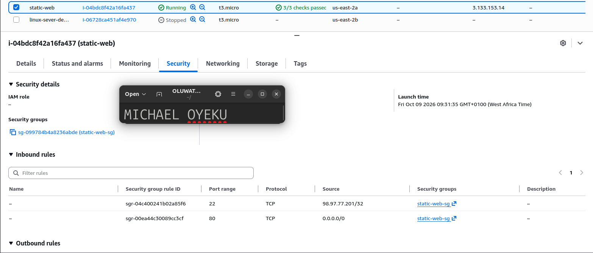

---

#### Screenshot 33 — Cloud VM Stack Verification

Add a VM terminal screenshot showing:

- Docker Compose service status
- Successful public health or API response
- No published database, frontend, or backend ports

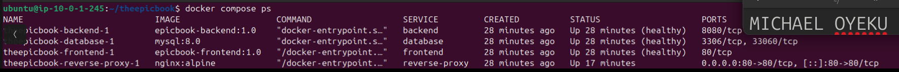

---

#### Screenshot 34 — EpicBook Application on Cloud VM

Add a browser screenshot showing the EpicBook application loaded through the VM public IP address.

Add your full name as a clear caption below the screenshot.

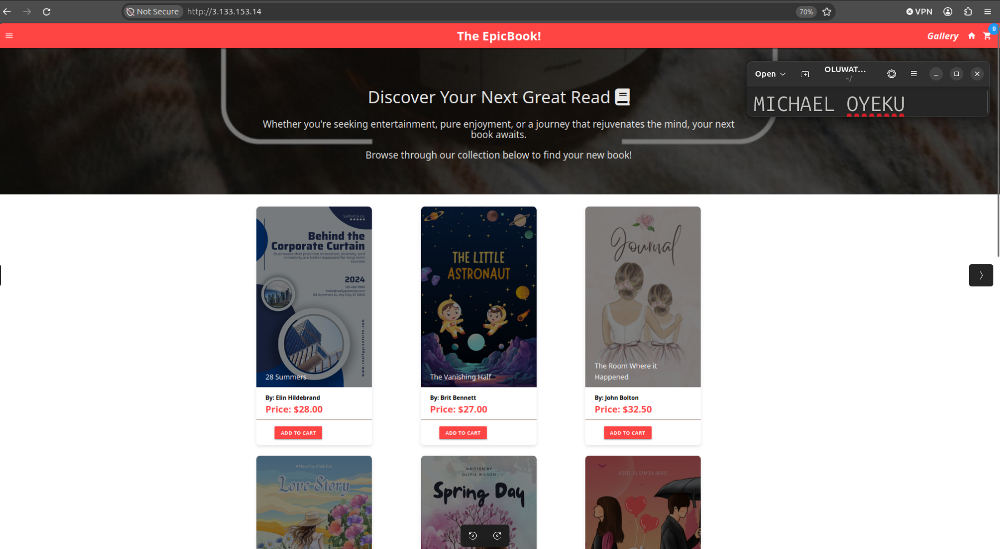

---

### Notes

Write a short note covering:

- Cloud provider used
- VM operating system
- Public port exposed
- Security rules configured
- Confirmation that the application and backend API worked through the reverse proxy

Write your note here.

Cloud Provider Used

The EpicBook application was deployed on Azure using a cloud-based Linux Virtual Machine.

Virtual Machine Operating System

The virtual machine runs Ubuntu 24.04 LTS].

Public Port Exposed

Only port 80 (HTTP) was publicly exposed through the reverse-proxy service. The frontend, backend, and database services communicate through internal Docker networks without publishing their service ports directly to the public internet.

Security Rules Configured

The cloud security rules were configured to allow:

SSH access on port 22, restricted to my authorised IP address.

HTTP traffic on port 80, accessible from the internet.

The database and backend ports were not exposed directly to the public network.

Deployment Verification

The deployment was verified by checking the Docker Compose service status, testing the public health endpoint, and accessing the EpicBook application through the virtual machine's public IP address.

Successful responses confirmed that the reverse proxy could route requests to the application services and that the backend API was accessible through the configured architecture.

---

# Task 8 — Automate Deployment with CI/CD (Optional)

## Goal

Optionally automate image build, image push, and deployment through GitHub Actions or Azure Pipelines.

### Optional Evidence

#### Optional Screenshot — Successful CI/CD Pipeline Run

Add a screenshot showing a successful pipeline run with build, image push, deployment, and verification stages.

Add your screenshot here.

---

### Optional Notes

Write a short note covering:

- CI/CD platform used
- Image-tagging method
- Registry used
- Deployment trigger
- Manual approval or secret-handling approach

Write your note here.


CI/CD Platform Used: [GitHub Actions/Azure Pipelines]

Image-Tagging Method: [Insert tagging strategy, e.g. Git commit SHA or version tag.]

Container Registry: [Insert registry used, e.g. Docker Hub or GitHub Container Registry.]

Deployment Trigger: [Insert trigger, e.g. successful push to the main branch.]

Approval and Secret Management: Sensitive credentials were managed through the CI/CD platform's secure secrets configuration rather than being hardcoded into workflow files or application source code.

The pipeline was designed to automate the image build, registry push, deployment, and verification stages, reducing repetitive manual deployment activities.

---

# Task 9 — Perform Reliability Tests and Create an Operations Runbook

## Goal

Test controlled service failures and document safe operating procedures.

### Evidence

#### Screenshot 35 — Backend Failure and Recovery

Add a terminal screenshot showing:

- Backend failure test
- Expected unavailable response through the reverse proxy
- Backend restart
- Successful health-check recovery

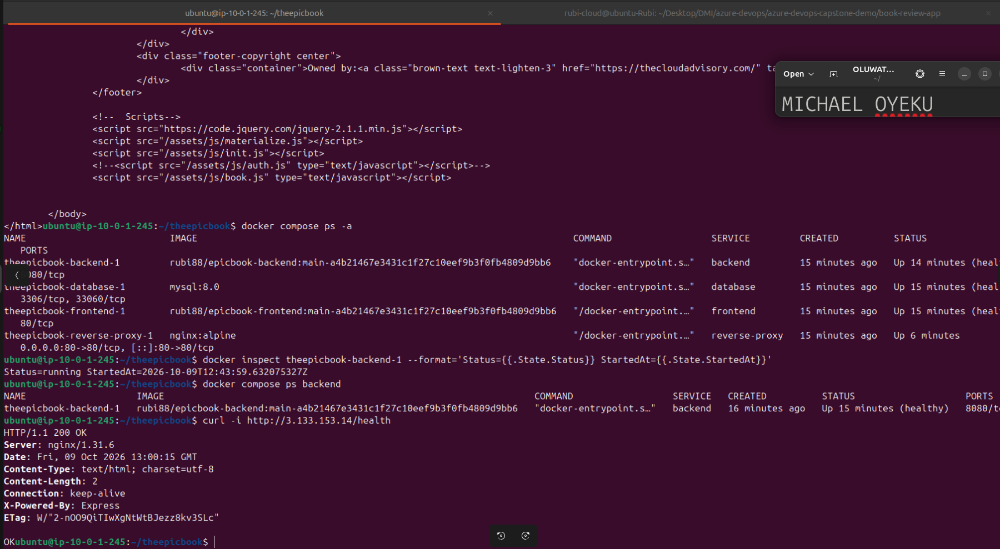

---

#### Screenshot 36 — Database Failure and Recovery

Add a terminal screenshot showing:

- Database outage test
- Failed database-dependent request
- Database restart
- Successful application recovery

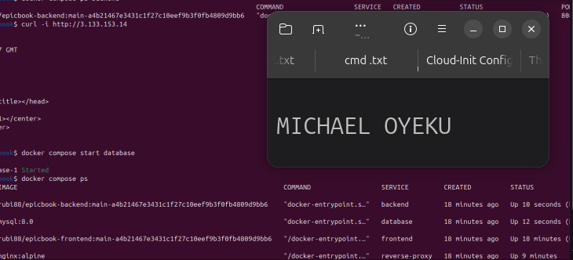

---

### Notes

Write a short operations runbook covering:

- Safe restart procedure for reverse proxy, frontend, backend, and database
- Backup and restore procedure
- Secret-rotation approach
- Database recovery procedure
- What to check when the application returns an error
- Results of backend and database reliability tests

Write your note here.

1. Safe Service Restart Procedure

The EpicBook application consists of four main services: reverse proxy, frontend, backend, and MySQL database.

To inspect running services:

docker compose ps

To restart an individual service:

docker compose restart reverse-proxy
docker compose restart frontend
docker compose restart backend
docker compose restart database

Where a dependency or configuration change requires recreation, use the appropriate Docker Compose deployment procedure and verify service health afterward.

2. Backup and Restore Procedure

Database backups should be performed regularly to protect application data against accidental deletion, corruption, or infrastructure failure.

A backup can be created using MySQL's database dump utility and stored in a designated host backup directory.

For restoration, the backup file should be imported into the appropriate MySQL database, followed by verification that the expected records and tables are available.

Backups should be stored securely, access-controlled, and periodically tested through restoration exercises.

3. Secret-Rotation Approach

Database passwords, application credentials, and other sensitive configuration values should be stored in protected environment files or an appropriate secrets-management solution.

When credentials need to be rotated:

Generate new credentials.

Update the relevant protected configuration.

Restart or recreate affected services as required.

Verify that application-to-database communication works.

Revoke the old credentials once the new credentials have been confirmed.

Secrets must never be committed to public source repositories or exposed in application logs.

4. Database Recovery Procedure

In the event of a database failure:

Inspect the database container status.

Review database logs for errors.

Check the database health-check result.

Restart the database service where appropriate.

Verify database connectivity from the backend.

Restore from a verified backup if data recovery is necessary.

The persistent named volume db_data should be protected against accidental deletion.

5. Troubleshooting Application Errors

When the EpicBook application returns an error, the following checks should be performed:

Inspect the status of all Docker Compose services.

Review reverse-proxy logs.

Check backend application logs.

Verify database health and connectivity.

Confirm that the required Docker networks are available.

Check environment-variable configuration.

Test the public health endpoint and relevant API routes.

These checks help isolate whether the problem originates from the reverse proxy, frontend, backend, or database.

6. Reliability Test Results

Backend Failure and Recovery: [Document the observed result of the backend failure test, the response through the reverse proxy, and successful recovery.]

Database Failure and Recovery: [Document the observed result of the database outage test, the failed database-dependent request, and successful application recovery.]

7. Operational Best Practices

The following practices should be maintained:

Monitor container health and application logs regularly.

Maintain scheduled database backups.

Test backup restoration periodically.

Protect database volumes against accidental deletion.

Rotate sensitive credentials when required.

Restrict public network access to necessary ports.

Verify application health after restarts and deployments.

---

# Final Public Application URL

**EpicBook URL:** `http://10.0.1.245

Replace the placeholder with your working public URL.

---

# GitHub Repository URL

**Your Fork or Repository URL:** `Add your GitHub repository URL here`

---

# LinkedIn Requirement

## Goal

Create a professional LinkedIn post of 6–10 lines about your EpicBook capstone deployment.

Your post must include:

- The architectural decision that most improved reliability
- Your biggest image-size reduction, with numbers
- Key production-hardening lessons
- A deployment verification image

### Evidence

**LinkedIn Post URL:** `Add your LinkedIn post URL here`

#### LinkedIn Post Screenshot

Add a screenshot of the published LinkedIn post showing the text body and deployment verification image.

---

# Submission Checklist

- [ ] EpicBook repository reviewed and architecture diagram created
- [ ] Environment variables, ports, persistence, and health-check details documented
- [ ] Backend and frontend production Dockerfiles created
- [ ] Backend runs as a non-root user
- [ ] Docker image-size comparison completed
- [ ] Docker Compose stack includes reverse proxy, frontend, backend, and database
- [ ] `front-tier` and `back-tier` networks configured
- [ ] `db_data` named volume configured
- [ ] MySQL, backend, frontend, and reverse-proxy health checks configured
- [ ] Startup dependencies use `service_healthy`
- [ ] Nginx or Traefik selected as the only public reverse proxy
- [ ] Only reverse-proxy port 80 is publicly published
- [ ] Same-origin routing configured and CORS used only when required
- [ ] Backup, restore, and persistence testing completed
- [ ] Reverse-proxy and backend logs verified
- [ ] Cloud VM deployment verified through the public IP
- [ ] Backend and database reliability tests completed
- [ ] Screenshots 1–36 included
- [ ] Required notes completed
- [ ] LinkedIn post URL and screenshot included
- [ ] Full name visible in required screenshots or captions
- [ ] No passwords, tokens, private keys, account IDs, or other sensitive information exposed

---

## 📌 About DMI & CloudAdvisory

DevOps Micro Internship (DMI) is a project-based DevOps program run by Pravin Mishra (The CloudAdvisory) focused on real-world execution, systems thinking, and career readiness.

It helps learners build strong DevOps foundations with hands-on experience.

---

## 📌 Resources

- 🌐 DMI Official Website: https://dmi.pravinmishra.com?utm_source=github&utm_medium=readme  
- 🎓 University: https://university.pravinmishra.com?utm_source=github&utm_medium=readme  
- 💬 Discord Community: https://discord.pravinmishra.com?utm_source=github&utm_medium=readme  
- 📝 Blog: https://dmi.pravinmishra.com/blog?utm_source=github&utm_medium=readme  
- ▶️ YouTube Playlist: https://www.youtube.com/playlist?list=PLFeSNDtI4Cho  
- 🔗 Pravin Mishra (LinkedIn): https://www.linkedin.com/in/pravin-mishra-aws-trainer/  
- 🏢 CloudAdvisory (LinkedIn): https://www.linkedin.com/company/thecloudadvisory/

---

*This submission is part of DevOps Micro Internship (DMI) — Agentic AI Track.*
